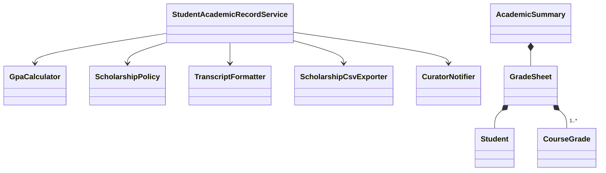

# Звіт до лабораторної роботи №7

**Тема:** Прагматичні принципи розробки та принципи об'єктно-орієнтованого дизайну SOLID
**Варіант:** 3 · **Мова:** Java 17+

**Мета:** набути практичних навичок аналізу legacy-коду, виявлення порушень SOLID, рефакторингу із застосуванням Dependency Injection та забезпечення чистоти коду за принципами DRY, KISS, YAGNI.

---

## Завдання 1. SRP — `StudentGradeManager`

### 1.1. Причини для зміни (reasons to change)

Метод `processStudentAcademicRecord` (≈70 рядків) змішує п'ять незалежних осей змін:

| № | Відповідальність | Хто ініціює зміну | Приклад зміни |
|---|---|---|---|
| 1 | Валідація вхідних даних | Методист / вимоги до даних | заборонити 0 кредитів ЄКТС |
| 2 | Розрахунок GPA і стипендії | Наказ ректора / Кабмін | нові пороги або суми стипендії |
| 3 | Формування текстової довідки | Деканат | інший вигляд довідки, PDF |
| 4 | Експорт у CSV | Бухгалтерія | інший роздільник, нові колонки, БД замість файлу |
| 5 | Надсилання куратору | ІТ-відділ | інший поштовий сервер, Telegram замість пошти |

Додаткові дефекти вихідного коду:
- `totalCredits == 0` дає ділення на нуль (`NaN` у GPA) — валідації кредитів немає;
- помилка запису CSV «ковтається» (`System.err`), і виклик вважається успішним;
- ім'я файлу `scholarship_registry.csv`, поштовий сервер і дата `LocalDate.now()` захардкоджені, тому код неможливо протестувати;
- `CourseGrade` змінюваний (сетери), отже інваріанти можна зламати вже після перевірки.

### 1.2. Декомпозиція

| Роль | Клас | Відповідальність |
|---|---|---|
| Доменна модель | `Student`, `CourseGrade`, `GradeSheet`, `AcademicSummary` | незмінні Value Objects; інваріанти перевіряються в конструкторі (fail-fast) |
| Сервіс | `GpaCalculator` | середньозважений бал за кредитами ЄКТС |
| Сервіс | `ScholarshipPolicy` | правила призначення стипендії (пороги 90/75, суми 2910/2000) |
| Сервіс | `TranscriptFormatter` | текстовий витяг з відомості |
| Сервіс | `ScholarshipCsvExporter` | запис у CSV (шлях і `Clock` передаються в конструктор) |
| Сервіс | `CuratorNotifier` | доставка відомості куратору |
| Оркестратор | `StudentAcademicRecordService` | лише послідовність кроків; залежності отримує через конструктор |

Валідацію перенесено в доменні об'єкти, а не в окремий клас-валідатор. Так об'єкт `CourseGrade` з оцінкою 120 просто неможливо створити, і жоден сервіс не мусить повторювати перевірку.



### 1.3. Метрики

WMC порахована як сума цикломатичної складності (CC) методів класу. CBO — кількість інших класів, з якими клас пов'язаний (типи проєкту + інфраструктурні класи JDK для вводу-виводу та дат).

| Клас | WMC | CBO | LCOM |
|---|---|---|---|
| **До:** `StudentGradeManager` | **20** (1 метод, CC = 20) | **8** (CourseGrade, BigDecimal, LocalDate, DateTimeFormatter, FileOutputStream, IOException, StandardCharsets, PrintStream) | формально 0 (немає полів), див. нижче |
| `Student` | 5 | 0 | 0 |
| `CourseGrade` | 7 | 0 | 0 |
| `GradeSheet` | 4 | 2 | 0 |
| `AcademicSummary` | 1 | 2 | 0 |
| `GpaCalculator` | 2 | 2 | — (без стану) |
| `ScholarshipPolicy` | 4 | 1 | — (без стану) |
| `TranscriptFormatter` | 2 | 3 | — (без стану) |
| `ScholarshipCsvExporter` | 3 | 6 (Files, Path, Clock, …) | 0 (обидва поля використовує `export`) |
| `CuratorNotifier` | 1 | 2 | — (без стану) |
| `StudentAcademicRecordService` | 4 | 8 | 0 (`process` використовує всі 5 полів) |

**Висновки:**
- **WMC:** максимальна складність класу впала з 20 до 7, складність оркестратора — до 4. Кожен клас можна зрозуміти й протестувати окремо.
- **CBO:** у сервісів CBO від 1 до 3. Чесне застереження: CBO оркестратора не зменшився (8), бо його роль саме координувати. Але змінилась *якість* зв'язків: оркестратор більше не залежить від файлової системи, форматів дат і кодувань, лише від власних сервісів. Інфраструктурні залежності (I/O) зосереджені в одному класі `ScholarshipCsvExporter`.
- **LCOM:** класична LCOM (Chidamber–Kemerer) рахується за спільним використанням *полів* методами. Вихідний клас не має полів і має один метод, тому формально LCOM = 0 («ідеальна» зв'язність). Насправді це процедура з п'ятьма незалежними блоками, яку метрика не помічає. Тому для God Object ми використали аналіз «причин для зміни» (п. 1.1). Після рефакторингу всі класи зі станом мають LCOM = 0: кожен метод використовує всі поля.

> Для захисту метрики можна перевірити автоматично плагіном **MetricsReloaded** або **CodeMR** в IntelliJ IDEA.

---

## Завдання 2. OCP — `NotificationSender`

### 2.1. Точка розширення

Точка розширення — **спосіб доставки повідомлення (канал)**. У вихідному коді вона захардкоджена як `switch (NotificationChannel)` по Enum. Щоб додати Viber, треба: (1) змінити Enum, (2) змінити `switch` у вже протестованому `NotificationSender`. Обидва файли відкриті для модифікації, отже OCP порушено.

> Вихідний код варіанта навіть не компілюється: у рядках `[PUSH]` і `[TELEGRAM]` неекрановані лапки й перенесення рядка всередині рядкового літерала. У рефакторингу це виправлено.

### 2.2. Рефакторинг (патерн Strategy)

- `NotificationChannel` — **інтерфейс-стратегія** з методом `boolean send(NotificationMessage)` (замість Enum).
- `EmailChannel`, `SmsChannel`, `PushChannel`, `TelegramChannel` — окремі стратегії. Логіка кожної гілки `switch` переїхала у свій клас.
- `NotificationSender.send(message, channel)` перевіряє аргументи й робить поліморфний виклик `channel.send(message)`. У ньому немає жодного `switch`/`if` за типом каналу.
- `NotificationMessage` — незмінний `record` з guard clauses; `priority` став enum `Priority` замість довільного рядка.

### 2.3. Демонстрація відкритості до розширення

Додано новий канал **`ViberChannel`** — один новий файл. У `NotificationSender`, `NotificationChannel` та інших каналах **не змінено жодного рядка** (див. `task2_ocp/Main.java`, де Viber використовується поряд з іншими).

---

## Завдання 3. LSP — `Rectangle` / `Square`

### 3.1. Аналіз порушення

Контракт `Rectangle` (неявний): *`setWidth` змінює лише ширину, `setHeight` лише висоту; після `setWidth(w); setHeight(h)` площа дорівнює `w·h`*.

`Square extends Rectangle` перевизначає сетери так, що кожен змінює обидві сторони. Отже:
- **постумова послаблена:** після `setWidth(5)` висота теж стала 5;
- **інваріант базового класу** (незалежність сторін) не зберігається.

Клієнт `AreaCalculator.resizeAndVerifyArea(Rectangle)` коректний для `Rectangle` (площа 50), але для `Square` отримує 100 і падає з винятком. Тобто нащадка не можна підставити замість базового типу без зміни поведінки програми, і це пряме порушення LSP. Наслідування тут моделює математичне «квадрат є прямокутником», але не поведінкове: *змінюваний* квадрат не поводиться як *змінюваний* прямокутник.

### 3.2. Рефакторинг

1. **Розділення ієрархії.** `Square` більше не успадковує `Rectangle`. Обидва реалізують спільний інтерфейс `Shape`, у якому лише операції, однаково коректні для всіх фігур: `area()` і `scale(factor)`. Контракт `scale` однаковий: площа множиться на `factor²`, оригінал не змінюється.
2. **Незмінні Value Objects.** `Rectangle` і `Square` — `record`. Замість сетерів — `withWidth/withHeight/withSide`, які повертають *новий* об'єкт. Немає мутації, отже немає й зламаних постумов.
3. **Guard clauses + fail-fast.** Розміри перевіряються в конструкторі через `Guards.requirePositive` (додатне скінченне число). Некоректну фігуру неможливо створити.
4. **Клієнт.** `resizeAndVerifyArea` приймає `Rectangle`, бо незалежна зміна сторін — поведінка лише прямокутника. Передати туди `Square` компілятор не дозволить: помилка, яка раніше була в runtime, тепер виявляється під час компіляції. `scaleAndVerify(Shape, k)` працює з будь-якою фігурою, перевіряє постумову і в разі порушення кидає `IllegalStateException`.

---

## Завдання 4. ISP — `IMultiFunctionDevice`

### 4.1. Аналіз клієнтів і ролей

«Жирний» інтерфейс з 5 методів змушує `BasicLaserPrinter` мати 3 заглушки, а `DocumentScanner` 4 заглушки з `UnsupportedOperationException`. Це 7 методів, які обіцяють поведінку, якої немає (заодно це порушення LSP). Клієнт, який отримав `IMultiFunctionDevice`, не знає, які методи безпечно викликати.

| Клієнт (сценарій) | Що реально викликає | Роль |
|---|---|---|
| `PrintQueue` — черга друку | `printDocument` | `Printer` |
| `ArchiveDigitizer` — оцифрування архіву | `scanDocument` | `Scanner` |
| `FaxDispatcher` — канцелярія | `sendFax` | `FaxMachine` |
| `BookletService` — друк брошур | `duplexPrint` + `staplePages` | `DuplexPrinter` + `Stapler` |

### 4.2. Сегрегація

- `Printer`, `DuplexPrinter extends Printer`, `Scanner`, `FaxMachine`, `Stapler` — рольові інтерфейси по одному-два методи. `DuplexPrinter` розширює `Printer`, бо будь-який duplex-принтер уміє й звичайний друк.
- `BasicLaserPrinter implements DuplexPrinter`, `DocumentScanner implements Scanner`. Заглушок не залишилось.
- `OfficeMultiFunctionDevice` — справжній БФП з предметної області, реалізує всі ролі (з guard clauses на номер факсу й кількість сторінок).

### 4.3. Клієнти

Кожен клієнт приймає в конструкторі *лише ту роль*, яку викликає. `new FaxDispatcher(laserPrinter)` не скомпілюється: помилку виявлено на етапі компіляції, а не винятком у runtime. `BookletService(mfd, mfd)` показує, що один пристрій може грати кілька ролей.

---

## Завдання 5. DIP — `FinancialTransactionProcessor`

### 5.1. Проблема

Високорівневий `FinancialTransactionProcessor` у конструкторі сам створює `new StripePaymentGatewayClient()`, `new SqlServerTransactionLedger()`, `new TwilioSmsNotifier()`. Бізнес-правило «списати → зафіксувати → повідомити» жорстко прив'язане до Stripe, SQL Server і Twilio: змінити провайдера чи протестувати без реальних грошей неможливо.

Додаткові дефекти: SMS «успішно виконано» надсилалось навіть при `FAILED`; повний номер картки потрапляв у лог; гроші зберігались у `double`; перевірялась лише сума.

### 5.2–5.3. Абстракції та Constructor Injection

```
core/ (високий рівень — володіє абстракціями)
  PaymentGateway        boolean charge(PaymentRequest)
  TransactionLedger     void record(PaymentRequest, TransactionStatus)
  PayerNotifier         void notifyPayer(PaymentRequest, TransactionStatus)
  FinancialTransactionProcessor(PaymentGateway, TransactionLedger, PayerNotifier)
         ▲ implements
infrastructure/ (низький рівень залежить від абстракцій core)
  StripePaymentGateway, SqlServerTransactionLedger, TwilioSmsNotifier
fakes/
  FakePaymentGateway, InMemoryTransactionLedger, RecordingNotifier
```

Інтерфейси лежать у пакеті `core`, поряд з бізнес-логікою, а не в `infrastructure`. Саме це і є *інверсія*: залежність спрямована від деталей до політики. Процесор отримує залежності через конструктор, перевіряє їх `Objects.requireNonNull` і більше не містить жодного `new` для інфраструктури.

### 5.4. Composition Root

`task5_dip/Main.java` — єдине місце, де створюються конкретні класи (Manual DI, як рекомендовано для Java в методичці):
- `productionProcessor()` — Stripe + SQL Server + Twilio;
- тестова конфігурація — `FakePaymentGateway(false)` + `InMemoryTransactionLedger` + `RecordingNotifier`. Той самий процесор без змін перевіряється трьома автоматичними перевірками (статус FAILED, запис у реєстрі, повідомлення про відмову).

**Service Locator не використовується:** процесор ніколи сам не запитує залежності з глобального реєстру. Усі залежності видно в сигнатурі конструктора.

---

## Завдання 6

### 6.1. DRY — де ліквідовано дублювання знань (SSOT)

| Завдання | Знання | Було | Стало (єдине джерело правди) |
|---|---|---|---|
| 1 | Межі оцінки, прохідний бал 60 | «магічні» числа всередині методу | константи `CourseGrade.MIN/MAX/PASSING_SCORE`, правило `CourseGrade.isFailed()` |
| 1 | Пороги й суми стипендії | літерали `2910.00`, `90.0` в `if` | `ScholarshipPolicy` — одне місце для наказу про стипендії |
| 1 | Коректність даних студента | перевірка в методі; кожен новий метод мав би її повторювати | інваріанти в конструкторах `Student`, `CourseGrade`, `GradeSheet` |
| 2 | Ліміт SMS | `160` і `157` (= 160 − 3) — одне знання, записане двічі | `SmsChannel.MAX_LENGTH` + `ELLIPSIS`, довжина обчислюється |
| 2 | Список підтримуваних каналів | Enum **і** `switch` (додавання в двох місцях) | лише набір реалізацій `NotificationChannel` |
| 3 | Правило «розмір > 0» | не було взагалі | `Guards.requirePositive` для всіх сторін і коефіцієнтів |
| 4 | Відсутність функції | 7 однотипних заглушок `throw new UnsupportedOperationException` | система типів: немає ролі → немає методу |
| 5 | Перевірка платежу | лише сума, всередині процесора | `PaymentRequest` (усі поля); маскування картки в `maskedCard()` |
| 5 | «Який текст SMS для статусу» | текст «успішно» незалежно від статусу | одне відображення статус → текст у `TwilioSmsNotifier` |

Свідомо залишене повторення: невеликі guard-методи (`requireText` тощо) у різних завданнях. Це незалежні модулі з різних предметних областей. Спільна утиліта зв'язала б їх між собою без реальної користі, а DRY стосується дублювання *знання*, а не схожих рядків коду.

### 6.2. KISS — зменшення складності

| Місце | До | Після |
|---|---|---|
| `StudentGradeManager.processStudentAcademicRecord` | CC = 20, вкладеність до 3 рівнів (`if → if → if-else` для стипендії, `if → try` для пошти), 5 обов'язків | найскладніший метод: `CourseGrade` (CC 6), без вкладеності |
| Призначення стипендії | `if (!failed) { if (gpa>=90) … else if (gpa>=75) … }` (Arrow Anti-Pattern) | `ScholarshipPolicy.determine`: 3 guard clauses з ранніми `return`, глибина 1 |
| `NotificationSender.send` | `switch` на 4 гілки + `default`, CC = 5 | 2 перевірки на null + 1 поліморфний виклик |
| `Square` | перевизначені сетери з неочевидним побічним ефектом | `record` з одним полем, без мутації |
| Клієнти принтера | мали б обгортати виклики в `try/catch UnsupportedOperationException` | викликають метод напряму, бо він гарантовано реалізований |

Guard clauses перевіряють некоректний стан на початку, а основний сценарій читається зверху вниз без вкладень. Читачеві не треба тримати в голові стек умов, тож когнітивна складність падає разом із цикломатичною.

### 6.3. YAGNI — чому абстракції не є over-engineering

Критерій: **кожна абстракція має щонайменше одну реальну реалізацію і хоча б одного клієнта вже зараз.**

- `NotificationChannel` — 5 реалізацій (4 з вихідного коду + Viber, якого вимагає завдання).
- `Shape` — 2 реалізації і реальний клієнт `scaleAndVerify`. «Про запас» не додавали ні `Circle`, ні `Triangle`.
- Рольові інтерфейси ISP — кожен реалізований пристроєм з предметної області і використаний клієнтом. `FaxMachine`/`Stapler` виправдані тим, що такі функції були у вихідному інтерфейсі, а `OfficeMultiFunctionDevice` їх реально має.
- Інтерфейси DIP — по 2 реалізації (production + fake), обидві використовуються в Composition Root.
- **Свідомо НЕ зроблено:** інтерфейси для сервісів завдання 1 (кожен має одну реалізацію, тож інтерфейс був би церемонією; виділимо, коли з'явиться друга), IoC-контейнер (вистачає Manual DI), фабрики/реєстри каналів, generic-ієрархія фігур.
- **Відсутні заглушки:** у проєкті немає жодного `UnsupportedOperationException`, порожнього методу чи `TODO` (перевірка: `grep -rn "Unsupported\|TODO" src` нічого не знаходить).

### 6.4. Крос-рев'ю та підготовка до захисту

**Рекомендований розподіл:** Студент А — завдання 1, 2, 3; Студент Б — завдання 4, 5. Завдання 6 і крос-рев'ю виконуються спільно.

**Чек-лист аудиту коду напарника:**
- [ ] Чи можна назвати одну причину зміни для кожного класу?
- [ ] Чи немає `switch`/`instanceof` за типом там, де можливий поліморфізм?
- [ ] Чи можна підставити кожну реалізацію замість інтерфейсу без винятків і без зміни поведінки клієнта?
- [ ] Чи немає методів-заглушок і `UnsupportedOperationException`?
- [ ] Чи немає `new` інфраструктурних класів поза Composition Root?
- [ ] Чи перевіряються інваріанти в конструкторах (fail-fast)?
- [ ] Чи всі доменні об'єкти незмінні?
- [ ] Чи компілюється проєкт і чи проходять перевірки в `task5_dip.Main`?

**Можливі питання на захисті:**
1. *Чому валідація в конструкторі record, а не в окремому `Validator`?* Невалідний об'єкт неможливо створити, тож перевірку не можна «забути» викликати, і вона не дублюється в кожному сервісі.
2. *Квадрат — це прямокутник. Чому не успадкування?* Математично так, поведінково ні: змінюваний квадрат не дотримується контракту змінюваного прямокутника. LSP стосується поведінки, а не таксономії.
3. *Чим DIP відрізняється від DI?* DIP — принцип (обидва рівні залежать від абстракції, яка належить верхньому рівню). DI — техніка передачі залежностей ззовні (у нас через конструктор).
4. *Чому Service Locator — антипатерн?* Залежності приховані всередині методів, не видно з сигнатури, і помилка конфігурації проявляється лише в runtime.
5. *Чи порушує OCP додавання `ViberChannel`?* Ні: ми додали новий код, не змінивши існуючого.
6. *ISP і LSP пов'язані?* Так: заглушки з `UnsupportedOperationException` у «жирному» інтерфейсі водночас порушують і LSP (реалізація не виконує контракт).

---

## Висновки

У ході роботи було проаналізовано 5 фрагментів legacy-коду варіанта 3 і усунуто порушення всіх принципів SOLID:
- God Object розбито на доменні Value Objects, сервіси й оркестратор (WMC 20 → ≤ 7);
- `switch` по Enum замінено патерном Strategy з демонстрацією розширення без модифікації;
- некоректне успадкування `Square extends Rectangle` замінено спільним інтерфейсом і незмінними об'єктами з guard clauses;
- «жирний» інтерфейс розділено на 5 рольових;
- жорстке зв'язування замінено Constructor Injection із Composition Root і підміною production/fake реалізацій.

Попутно виправлено реальні дефекти: ділення на нуль, хибне SMS про успіх, логування номера картки, `double` для грошей, некомпільований вихідний код. Прагматичний аналіз показав, що абстракції створені лише там, де вже є кілька реалізацій або клієнтів, тобто без надлишкового проєктування.
